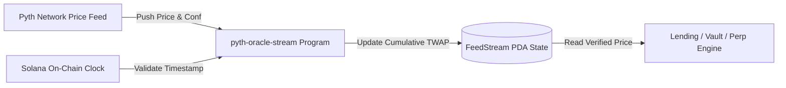

# Solana Pyth Oracle Stream

[](https://solana.com)
[](https://coral-xyz.github.io/anchor/)
[](https://pyth.network)
[](https://opensource.org/licenses/Apache-2.0)

A high-performance on-chain oracle consumer and moving TWAP (Time-Weighted Average Price) accumulator on Solana built with the **Anchor Framework** and **Pyth Network SDK**.

Designed for lending protocols, perpetual futures engines, and automated liquidity vaults requiring tamper-resistant price feeds with strict confidence bounds and staleness verification.

---

## 🌟 Architecture & Key Capabilities

- **Zero-Staleness Enforcement**: Strictly verifies price feed validity against maximum allowed elapsed seconds from on-chain `Clock`.
- **Dynamic Confidence Bounds**: Filters out volatile outliers by enforcing strict confidence interval ratio thresholds (`conf / price <= max_conf_bps`).
- **Cumulative TWAP Accumulator**: Maintained on-chain via dedicated Program Derived Addresses (PDAs) with overflow-checked mathematical precision.
- **Composable CPI Hooks**: Exposes standard Anchor CPI endpoints for integration with downstream DeFi protocols.



---

## 📂 Project Structure

```text
solana-pyth-oracle-stream/
├── Anchor.toml                     # Anchor configuration
├── Cargo.toml                      # Root Rust workspace
├── package.json                    # Node.js dependencies
├── tsconfig.json                   # TypeScript configuration
├── programs/
│   └── pyth-oracle-stream/
│       ├── Cargo.toml              # Rust crate dependencies
│       └── src/
│           └── lib.rs              # Anchor instructions and PDA schemas
└── tests/
    └── pyth-oracle-stream.ts       # Mocha integration tests
```

---

## 🚀 Quick Start

### Build Smart Contract

```bash
git clone https://github.com/tancyclamen/solana-pyth-oracle-stream.git
cd solana-pyth-oracle-stream
yarn install
anchor build
```

### Run Tests

```bash
anchor test
```

---

## 📜 Program Instructions

### 1. `initialize_feed_stream`
Derives and initializes a `FeedStreamState` PDA for a target Pyth price feed, configuring `max_staleness_seconds` and `max_conf_ratio_bps`.

### 2. `record_price_sample`
Pulls the latest price feed data, verifies that `clock.unix_timestamp - price.publish_time <= max_staleness`, verifies confidence ratio, and adds the sample to `cumulative_price_sum`.

### 3. `set_stream_status`
Enables the stream authority to pause or resume sampling during market circuit breakers.

---

## 📄 License

Licensed under the [Apache License, Version 2.0](LICENSE).
